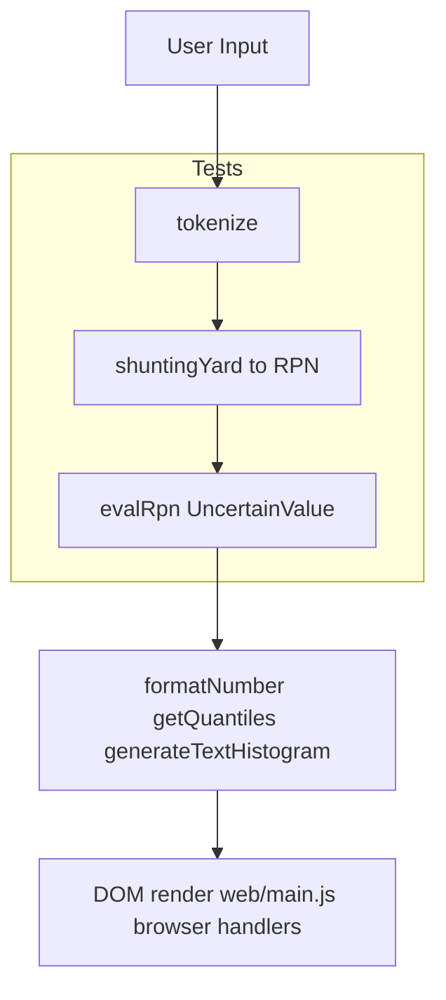

# unsure-calc

Lightweight probabilistic calculator that lets you type ranges (with `~`) and arithmetic to see exact bounds plus simulated outcomes and a text histogram.

It also supports currency expressions with step-by-step simplification, e.g.:

`120usd + 50eur to pln`

Notes:
- `to <currency>` converts the expression result to the target currency.
- A currency suffix on a range applies to the whole range: `1~10eur` is the same as `(1~10)eur`, and `10eur~20eur` is a range in EUR.
- Trailing arithmetic after conversion is supported (`to pln * 20 * 12`).
- Web app fetches daily FX rates (once per local day) from Frankfurter/ECB for 25 major currencies (EUR base + 24 symbols).
- Supported symbols in daily feed: `EUR, USD, GBP, JPY, CHF, CAD, AUD, NZD, SEK, NOK, DKK, PLN, CZK, HUF, RON, TRY, CNY, HKD, SGD, KRW, INR, MXN, BRL, ZAR, AED`.
- If live fetch fails, the app falls back to a local EUR/PLN snapshot (`4.22`).
- Rates can still be overridden programmatically with `evaluateExpressionWithSteps(..., { currencyRates })`.
- `a~b` is sampled as a normal distribution with `a` and `b` at its P5 and P95. A range that does not cross zero never samples across it, so `1~10` stays non-negative.
- Sampling uses a fixed seed (42), so the same expression always gives the same simulated numbers.
- The likely range defaults to P5-P95. Pick another with the presets or by dragging the band edges on the histogram (arrow keys work on a focused edge); it is kept in the URL as `?p=10-90`.
- The web app keeps the last 30 expressions it calculated (typed or opened from a link) in localStorage. Focus the input (or click the clock icon) for a dropdown of them, filtered as you type; Up/Down and Enter rerun one, Shift+Delete or the x removes one. Nothing leaves the browser.
- The web chart draws the samples as a smoothed density curve (Gaussian kernel, Silverman bandwidth). Hover it for the share of outcomes at or below a value; "Show as table" lists the binned counts.

Deployed at: https://calc.pythonic.ninja

## Getting started
1. Install prerequisites: `node` (v18+ for `node:test`) and `python3` for the simple dev server.
2. Run `make dev` then open `http://localhost:8000/web/` (override port with `DEV_PORT=9000 make dev`).
3. Run `make test` to execute the Node unit tests.

## Project structure (root)
- `core/calc-core.js` — single source of calculator logic used by web, Raycast, and tests.
- `core/tests/` — `node:test` suite covering tokenizer, unary minus, precedence, and range evaluation.
- `web/` — static site (Tailwind UI + browser controller).
- `raycast-extension/` — Raycast command code and manifest.
- `Makefile` — quick commands for local dev and tests.

## Makefile cheatsheet
- `make dev` — serve the app via `python3 -m http.server $(DEV_PORT)` (defaults to 8000).
- `make test` — run the Node test suite (`node --test core/tests/*.test.js`).
